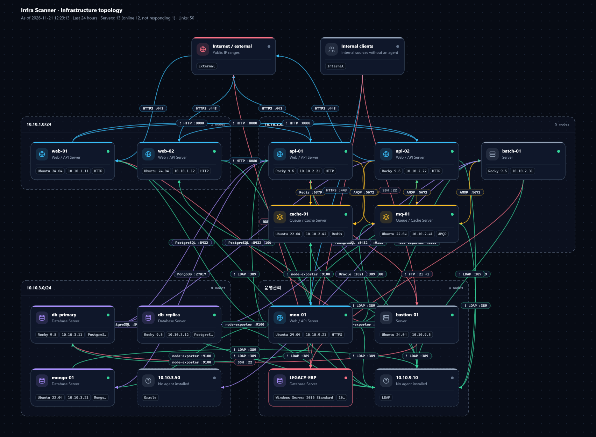
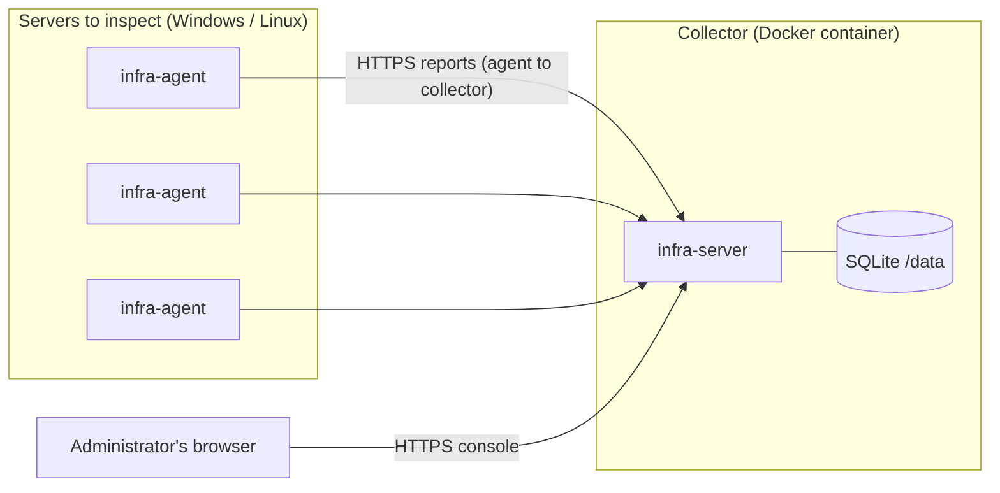

# Infra Scanner

[한국어](README.md) | **English**

A web app that **draws your data-center topology automatically and flags items to check**, using what agents installed on your servers observe.

> **Free for everyone.** This is a public repository released under the [MIT License](LICENSE). Any person, company or organization may use, modify and redistribute it free of charge, including for commercial purposes. No permission or registration is needed.



*A topology built from demo data (`demo-seed`) and exported with the console's "Save the topology as PNG" button.*

## Contents

- [Purpose](#purpose)
- [Features](#features)
- [How it works](#how-it-works)
- [Quick start (Docker)](#quick-start-docker)
- [Installing the agent](#installing-the-agent)
- [Using the console](#using-the-console)
- [Switching language (한국어 / English / 中文)](#switching-language-한국어--english--中文)
- [Checks](#checks)
- [Configuration (environment variables)](#configuration-environment-variables)
- [Security](#security)
- [What is collected](#what-is-collected)
- [Operations](#operations)
- [Building from source and running the demo](#building-from-source-and-running-the-demo)
- [API](#api)
- [Project layout](#project-layout)
- [Known limitations and what has been verified](#known-limitations-and-what-has-been-verified)
- [License and terms of use](#license-and-terms-of-use)

## Purpose

Topology diagrams are usually drawn by hand, and they start drifting from reality the day they are drawn. During an incident or a security review, the answer to "what does this server talk to?" ends up coming from someone's memory instead of from a document.

Infra Scanner addresses this as follows.

1. **Observe the topology instead of drawing it.** The agent on each server reads the listening ports and the TCP connections that actually exist and reports them. The collector matches the reports against each other to build the links between servers, so the diagram always shows what is observed now.
2. **Treat Windows and Linux the same way.** The agent is a single executable with no dependencies, and one install command registers it as a service.
3. **Inspect, not only display.** Agents that stopped responding, full disks, management or database ports reached from the Internet, traffic that may be plaintext and servers without an agent are found automatically and shown by severity.
4. **Keep deployment simple.** The collector is one Docker container and the data is one SQLite file. No separate database or message queue is needed.
5. **Work for operators in different countries.** The console can be switched between Korean, English and Chinese.

The visual design follows `test.html` in this repository, an editor for drawing topologies by hand. Infra Scanner fills the same kind of diagram automatically with what the agents collect.

## Features

| Area | Description |
| --- | --- |
| Automatic topology | Server nodes, grouped by subnet or by a zone name you choose, with links colored by service type |
| Server-to-server links | The peer address one server reports is matched against the addresses of the other agents. When both ends run the agent, the connecting and the receiving process names are shown |
| Targets without an agent | Internal addresses without an agent appear as "No agent" nodes. Public IP addresses and internal clients are each grouped into a single node |
| Server details | OS, kernel, CPU, memory, disks, network interfaces, listening ports, inbound and outbound traffic |
| Checks | 14 checks shown as high / medium / low ([Checks](#checks)) |
| Period | Draw only the traffic observed in the last 1 hour, 6 hours, 24 hours, 7 days or 30 days |
| Layout | Drag nodes and zones; the layout is saved on the collector. "Auto layout" restores the automatic arrangement |
| Export | Save the topology as PNG or JSON |
| Languages | 한국어, English, 中文 (Simplified) |
| Deployment | One Docker image containing the collector and the agents for Linux (amd64, arm64) and Windows (amd64) |

## How it works



1. **Enrollment.** At install time the agent enrolls once with the enrollment token (`ENROLL_TOKEN`) and receives a token of its own. The enrollment token is then removed from the agent's config file.
2. **Collection.** Every 10 seconds the agent reads the open sockets to learn which process is connected to which port on which address. At each report interval (60 seconds by default) it sends that together with the server information. Packet contents are never read.
3. **Linking.** The collector matches the peer addresses in each report against the interface addresses reported by the other agents. If an agent matches, the two servers are linked. Otherwise an internal address becomes a "No agent" node and a public address is grouped into the "Internet" node.
4. **Display.** The browser fetches the topology and the check results again every 30 seconds.

Traffic always flows **one way, from the agent to the collector**. The collector cannot connect to the servers or send them commands, so no new port has to be opened on the servers being inspected.

## Quick start (Docker)

You need Docker and Docker Compose.

```bash
git clone <URL of this repository>
cd infra_scanner
cp .env.example .env
```

Open `.env` and fill in two values.

| Value | Description |
| --- | --- |
| `ADMIN_PASSWORD` | Password for the console. At least 12 characters |
| `ENROLL_TOKEN` | Agent enrollment token. A random value of at least 24 characters, for example from `openssl rand -base64 32` |

If you list the names or IP addresses used to reach the collector in `TLS_HOSTS` (for example `TLS_HOSTS=scanner.example.internal,10.0.0.5`), they are included in the self-signed certificate.

```bash
docker compose up -d --build
docker compose logs -f
```

Open `https://<collector address>:8443` in a browser. With the default setting (`TLS_MODE=selfsigned`) the collector creates its own certificate, so the browser shows a certificate warning the first time. Check that the fingerprint the browser shows matches the "SHA-256 fingerprint" line in the log before you continue. To use a certificate from your own CA, see `TLS_MODE=files` under [Configuration](#configuration-environment-variables).

If the build fails with `x509: certificate signed by unknown authority` because of a TLS-inspecting proxy on your network, follow `docker/certs/README.txt`.

Note: the collector's log messages and the comments in `.env.example` are written in Korean.

## Installing the agent

1. Click **Install agent** at the top right of the console.
2. In **Collector URL**, enter the address at which the target servers can reach the collector. Optionally enter a **Zone** name (for example `prod-dmz`). If you leave it empty, servers are grouped by subnet.
3. Copy the command shown and run it on the target server. Replace `<ENROLL_TOKEN>` with the value from `.env`.

The commands look like this. The console fills in the real address, file hash and certificate fingerprint.

Linux (as root):

```bash
curl -fkLo infra-agent https://scanner.example.internal:8443/downloads/infra-agent-linux-amd64
echo "<SHA-256 shown in the console>  infra-agent" | sha256sum -c - && chmod +x infra-agent
sudo ./infra-agent install -server https://scanner.example.internal:8443 -token '<ENROLL_TOKEN>' -server-cert-sha256 <fingerprint shown in the console>
```

Windows (PowerShell as administrator):

```powershell
curl.exe -fkLo infra-agent.exe https://scanner.example.internal:8443/downloads/infra-agent-windows-amd64.exe
if ((Get-FileHash .\infra-agent.exe -Algorithm SHA256).Hash -ne "<SHA-256 shown in the console>") { throw "SHA-256 mismatch" }
.\infra-agent.exe install -server https://scanner.example.internal:8443 -token "<ENROLL_TOKEN>" -server-cert-sha256 <fingerprint shown in the console>
```

`-k` is added only for a self-signed certificate. It skips certificate verification for the download, but the next line compares the file's SHA-256 with the value from the console, and the agent connects only to a certificate with the fingerprint given in `-server-cert-sha256`.

The server appears in the topology within a minute of installation.

### Agent commands

| Command | Description |
| --- | --- |
| `infra-agent install -server URL -token TOKEN [options]` | Enrolls, installs the service and starts it. Running it again upgrades or reinstalls |
| `infra-agent uninstall [-purge]` | Removes the service. `-purge` also deletes the config and the enrollment |
| `infra-agent run [-config PATH]` | Runs in the foreground without a service |
| `infra-agent once [-zone NAME]` | Collects once and prints JSON. Nothing is sent, so you can preview what would be reported |
| `infra-agent version` | Prints the version |

`install` options:

| Option | Description |
| --- | --- |
| `-zone NAME` | Zone to group the server under in the topology. Without it, servers are grouped by subnet |
| `-interval N` | Report interval in seconds. Default 60, range 15 to 3600 |
| `-ca FILE` | Certificate of your own CA (PEM), used to verify the collector's certificate |
| `-server-cert-sha256 FP` | SHA-256 fingerprint of the collector's self-signed certificate. The agent connects only to that certificate |
| `-allow-http` | Allows a plain HTTP collector. For testing only |

Install locations:

| | Windows | Linux |
| --- | --- | --- |
| Executable | `%ProgramFiles%\InfraScanner\infra-agent.exe` | `/usr/local/bin/infra-agent` |
| Config and token | `%ProgramData%\InfraScanner\` (`agent.json`, `state.json`) | `/etc/infra-scanner/` |
| Service name | `InfraScannerAgent` | `InfraScannerAgent` |
| Log | `%ProgramData%\InfraScanner\agent.log` | The service manager's log (with systemd, `journalctl -u InfraScannerAgent`) |

The agent must run as administrator (root) to read the names of other processes. `install` refuses to run without those privileges.

Note: the agent's command-line output is written in Korean.

## Using the console

### Signing in

Sign in with `ADMIN_PASSWORD`. Five wrong attempts from the same address lock sign-in for five minutes. A session lasts 12 hours.

### Top bar

| Item | Description |
| --- | --- |
| Servers / Online / Not responding / No agent / Links | Current counts. In a narrow window the most important ones stay and the rest are hidden |
| Checks `high/medium/low` | Number of check results. Click to open the overview and the check results on the right |
| Period | Only traffic observed within this period is drawn |
| External | Shows or hides the Internet and internal-client nodes |
| No agent | Shows or hides internal servers that have no agent |
| Shared | Shows or hides links to services every server shares, such as monitoring, DNS, LDAP and NTP. Turn it off to keep only application flows |
| Labels / Flow | Turns link labels and the flow animation on or off |
| Auto layout | Discards the saved layout and arranges automatically |
| Save as PNG / JSON | Saves the topology as shown. The JSON can be opened with the import button ("JSON 불러오기") in the `test.html` editor, whose own interface is in Korean |
| Install agent | Shows the install commands |
| Language | 한국어 / English / 中文 ([Switching language](#switching-language-한국어--english--中文)) |
| Sign out | Ends the session |

### Topology

- Click a **node** to open its details on the right. Drag it to move it; the position is saved on the collector.
- Drag a **zone** by its title bar to move the whole zone.
- Click a **link** to see its services, processes, concurrent connections and the time it was last observed. A `!` in front of a label means the link includes traffic that may be plaintext (guessed from the port).
- Drag empty space to pan. Use the mouse wheel or the buttons at the bottom right to zoom in, zoom out, fit to screen and refresh.
- The dot at the top right of a node is its status: green (online), red (not responding), amber (awaiting report), grey (no agent / external).
- Link colors: sky blue (web / API), purple (database), amber (queue / cache), red (remote management), green (infrastructure services), grey (other).

### Left list

Servers listed by zone. Search by hostname, IP address or service name. Click an entry to move the topology to that server.

### Right panel

- **Overview**: the counts and the check results. Filter by severity, and click a result to go to the server or link concerned.
- **Server details**: system information, resource usage, network interfaces, listening ports, outbound traffic, inbound traffic and traffic within the server. "Remove this server from the list" at the bottom deletes the collected records and the agent's enrollment. If the agent keeps running it will fail authentication, so reinstall it on that server to resume reporting.
- **Link details**: the connecting and receiving sides, with processes and observation times per service.

A server changes to **Not responding** when no report has arrived for three times its report interval (at least 3 minutes).

## Switching language (한국어 / English / 中文)

- Pick **한국어 / English / 中文** in the selector with the globe icon, on the sign-in screen or in the top bar. The whole console changes immediately, without a reload.
- The choice is saved in that browser. If you have never chosen, the browser's language setting is used, and English is shown when it is none of the three.
- Chinese is Simplified Chinese (简体中文).
- What changes: menus and buttons, statuses, titles and descriptions of the checks, error messages, the install guide, the header of the PNG export and the check texts in the JSON export.
- What does not change: values you chose, such as hostnames and zone names, and values that come from the operating system (OS names, process names, the cause text of agent warnings).
- The agent's command-line output and the collector's log are in Korean. API error responses carry a Korean sentence (`error`) together with a language-neutral code (`code`).

### Adding a language

1. Add a block for the new language to `web/static/i18n.js`. The keys must be identical to English (`en`), and so must the `{name}` placeholders.
2. Add one line `['code', 'display name', 'html lang value']` to `LANGS` in `web/static/app.js`.
3. Add the code to `uiLanguages` in `internal/server/i18n_test.go` and run `go test ./internal/server`. It reports missing keys and mismatched placeholders.

Corrections to the translations and new languages are welcome.

## Checks

| Severity | Check | Condition |
| --- | --- | --- |
| High | Agent not responding | No report for three times the report interval (at least 3 minutes) |
| High | Disk almost full | Usage of 95% or more |
| High | Telnet port listening | Listening on TCP 23 on a non-loopback address |
| High | Management/DB port reached from the Internet | Connections from public IP addresses to a management or database port were observed |
| Medium | High disk usage | Usage of 90% or more |
| Medium | High memory usage | Usage of 90% or more |
| Medium | FTP port listening | Listening on TCP 21 on a non-loopback address |
| Medium | Plaintext protocol in use | FTP or Telnet traffic was observed |
| Low | Possibly plaintext traffic (guessed from the port) | Traffic that may be plaintext judging by the port, such as HTTP or LDAP, was observed |
| Low | Server without an agent | An internal address that servers with an agent connect to, but that has no agent |
| Low | Enrolled but not reporting | The agent enrolled but has not reported yet |
| Low | Some process names missing | The process name could not be read for more than half of the listening ports. This happens when the agent does not run as administrator |
| Low | Some flows omitted | More flows than one report can carry (1000) |
| Low | Agent collection warning | The agent could not read some information |

Service names and the plaintext flag are **guesses based on the port number**. Traffic on port 8080, for example, is shown as "HTTP, possibly plaintext" although it may in fact be TLS. The results narrow down what to look at; they are not verdicts.

## Configuration (environment variables)

The collector is configured entirely through environment variables. With Docker Compose, put them in `.env`.

| Variable | Default | Description |
| --- | --- | --- |
| `ADMIN_PASSWORD` | (required) | Console password, at least 12 characters. In `.env`, write `$$` for a `$` in the value |
| `ENROLL_TOKEN` | (required) | Agent enrollment token, at least 24 characters |
| `TLS_MODE` | `selfsigned` | `selfsigned`: the collector creates a certificate and agents verify it by fingerprint. `files`: use a certificate you were issued. `off`: plain HTTP; use it only when a reverse proxy in front terminates HTTPS |
| `TLS_HOSTS` | (none) | Names and IP addresses to put in the self-signed certificate, separated by commas |
| `TLS_CERT_FILE`, `TLS_KEY_FILE` | (none) | Paths of the certificate and key for `TLS_MODE=files`. Uncomment the `./certs` volume in `docker-compose.yml` and give the paths inside the container (`/certs/...`) |
| `PUBLISH_PORT` | `8443` | Port opened on the host (Compose only) |
| `RETENTION_DAYS` | `30` | How many days flow records are kept |
| `COOKIE_SECURE` | `true` | Sets the Secure attribute on the session cookie. Use `false` only when testing without HTTPS |
| `VERSION` | `1.0.0` | Image tag and displayed version (Compose only) |
| `LISTEN_ADDR` | `:8443` | Address the collector listens on. Used when running it outside the container |
| `DATA_DIR` | `./data` | Folder for the SQLite file and the self-signed certificate (`/data` in the image) |
| `DOWNLOADS_DIR` | `./downloads` | Folder holding the agent executables (`/app/downloads` in the image) |

To change `TLS_HOSTS` after the self-signed certificate has been created, delete `/data/tls` in the volume and restart. The fingerprint changes, so the agents have to be reinstalled as well.

## Security

- **Encryption in transit.** HTTPS is the default. The agent rejects an `http://` address unless `-allow-http` is given, and pins a self-signed certificate by its fingerprint.
- **Tokens.** The enrollment token is used only for enrollment and is never shown in the console. After enrollment each server uses its own token, and the collector stores only its hash. Removing a server from the list invalidates its token at once.
- **Agent files.** The config folder that holds the token is readable by administrators only (`0700` on Linux; SYSTEM and Administrators only on Windows).
- **Console.** The session cookie is `HttpOnly`, `SameSite=Strict` and `Secure`, and sign-in attempts are limited. Requests that change state require a dedicated header, and the pages are served with a `default-src 'self'` content security policy. The console uses no external CDN, so it also works on networks without Internet access.
- **Container.** It runs as a non-root user in a distroless image without a shell, with a read-only root file system and all capabilities dropped.
- **One way.** The collector cannot connect to agents or send them commands.

When you operate it:

- Do not commit `.env` (it is listed in `.gitignore`). Use long random values for `ADMIN_PASSWORD` and `ENROLL_TOKEN`.
- There is a single administrator account and no per-user permissions. Restrict access to the console to your management network with a firewall.
- The collector accumulates the layout and communication relationships of all your servers, which is sensitive in itself. Protect the collector and its backups accordingly.

If you find a security problem, please contact the repository maintainer before describing how to reproduce it in a public issue.

## What is collected

You can see exactly what the agent sends by running `infra-agent once` on the server.

| Collected | Not collected |
| --- | --- |
| Hostname, OS and kernel version, architecture, virtualization type, uptime | Packet contents, request and response bodies |
| CPU model and usage, memory and disk usage | File contents, environment variables, command-line arguments |
| Network interface names, MAC and IP addresses | Accounts and passwords, certificates and keys |
| Listening ports (TCP / UDP) and their process names | User activity, log files |
| For TCP connections: direction, peer IP address, service port, process name, number of concurrent connections | UDP traffic flows |

## Operations

| Task | How |
| --- | --- |
| View logs | `docker compose logs -f` |
| Health check | `GET /healthz` (the container has a HEALTHCHECK) |
| Upgrade | Pull the new source, then `docker compose up -d --build`. The data stays in the `infra-data` volume |
| Upgrade an agent | Run `install` again with the new executable. Without a token it keeps the existing enrollment |
| Backup | Back up the `infra-data` volume (`/data`), which holds `infra-scanner.db` and `tls/`. Copying it while the container is stopped is safest |
| Remove a server | Run `infra-agent uninstall -purge` on the server, then "Remove this server from the list" in the console |
| Rotate the enrollment token | Change `ENROLL_TOKEN` in `.env` and restart. Agents that are already enrolled are not affected |

## Building from source and running the demo

Go 1.27.4 or later is required (see `go.mod`). The console's static files are embedded in the collector executable, so rebuild the collector after changing `web/static`.

```bash
go test ./internal/...

go build -o dist/infra-server ./cmd/server
go build -o dist/demo-seed ./cmd/demo-seed
GOOS=linux   GOARCH=amd64 go build -o dist/downloads/infra-agent-linux-amd64       ./cmd/agent
GOOS=windows GOARCH=amd64 go build -o dist/downloads/infra-agent-windows-amd64.exe ./cmd/agent
```

To look around the console without any agents, load the demo data. `demo-seed` sends data to the collector as if 13 fictional servers were reporting.

```bash
export ADMIN_PASSWORD='a-password-for-local-use-only'
export ENROLL_TOKEN="$(openssl rand -base64 32)"
export LISTEN_ADDR=127.0.0.1:8080 TLS_MODE=off COOKIE_SECURE=false
export DATA_DIR=dist/demo-data DOWNLOADS_DIR=dist/downloads
./dist/infra-server &

./dist/demo-seed -server http://127.0.0.1:8080 -allow-http -loop
```

Open `http://127.0.0.1:8080`. Use `TLS_MODE=off` and `COOKIE_SECURE=false` only for testing on your own PC.

## API

| Method and path | Authentication | Description |
| --- | --- | --- |
| `GET /healthz` | None | Health check |
| `POST /api/v1/agent/enroll` | Enrollment token | Enrolls an agent and issues its own token |
| `POST /api/v1/agent/report` | Agent token | Reports collected data |
| `GET /downloads/{name}` | None | Agent executables |
| `POST /api/v1/login`, `POST /api/v1/logout`, `GET /api/v1/me` | Password / session | Console sign-in |
| `GET /api/v1/topology?window=24h` | Session | Topology, counts and check results |
| `GET /api/v1/hosts/{id}`, `DELETE /api/v1/hosts/{id}` | Session | Server details, removal |
| `PUT /api/v1/layout`, `DELETE /api/v1/layout` | Session | Save and reset the layout |
| `GET /api/v1/install-info` | Session | Information used by the install guide |

Responses are language-neutral. A check result carries a `code` and `args` instead of sentences (for example `{"severity":"high","code":"agent_offline","args":{"host":"db-01","age_sec":340}}`), and an error has the form `{"code":"bad_password","error":"..."}`. The console builds the sentences in the selected language from `f.<code>.title`, `f.<code>.detail` and `err.<code>` in `web/static/i18n.js`.

## Project layout

```text
cmd/
  agent/        infra-agent: install, uninstall and run commands
  server/       infra-server: the collector
  demo-seed/    tool that sends demo data
internal/
  agent/        collection (sockets, host information), enrollment, sending
  server/       API, authentication, storage (SQLite), topology building, checks, TLS
  model/        report format exchanged by the agent and the collector
web/static/     console: index.html, app.js, app.css, i18n.js (translations)
docker/certs/   place for a corporate CA used only during the build
docs/           images for the documentation
Dockerfile, docker-compose.yml, .env.example
test.html       the topology editor the design is based on (a standalone file)
```

External dependencies are [gopsutil](https://github.com/shirou/gopsutil) (BSD-3-Clause), [kardianos/service](https://github.com/kardianos/service) (zlib) and [modernc.org/sqlite](https://gitlab.com/cznic/sqlite) (BSD-3-Clause). The console is written without a framework.

Note: comments in the source code are written in Korean.

## Known limitations and what has been verified

- **Short connections can be missed.** Sockets are read every 10 seconds, so a connection that opens and closes in between is not observed. This is not a replacement for packet capture or eBPF-based tools.
- **Service names and the plaintext flag are guesses based on the port number.**
- **Only TCP flows become links.** For UDP only listening ports are collected.
- **Traffic behind NAT or a load balancer** is shown with the address the agent saw, so it may not be linked to the real peer server. Addresses that several servers share (for example `docker0`) cannot be attributed and are not used for linking.
- **Traffic inside containers** is collected only as far as it is visible through the host's sockets.
- **There is a single administrator account.** There are no per-user permissions, no audit log and no notifications (mail, chat).
- **The agent's command-line output and the collector's log are in Korean.**
- **What has been verified.** Unit tests, and running the collector directly on Windows and checking the console with demo data. Building the Docker image, installing the service on Windows and Linux, and fleets of hundreds of servers or more have not yet been verified in a real environment. Test in a staging environment before putting it into production.

## License and terms of use

[MIT License](LICENSE).

- **Anyone** may use, copy, modify, merge, publish, distribute, sublicense and sell it free of charge. This applies to individuals, companies and organizations alike, and commercial use is allowed.
- There is one condition: keep the copyright notice and the license text with copies or substantial portions of the software.
- The software is provided "as is", without warranty of any kind. You use it at your own risk.
- Install the agent **only on servers you own or are authorized to manage**. Collecting information from systems without authorization is illegal in most countries.

Bug reports, feature suggestions, translation fixes and pull requests are welcome.
