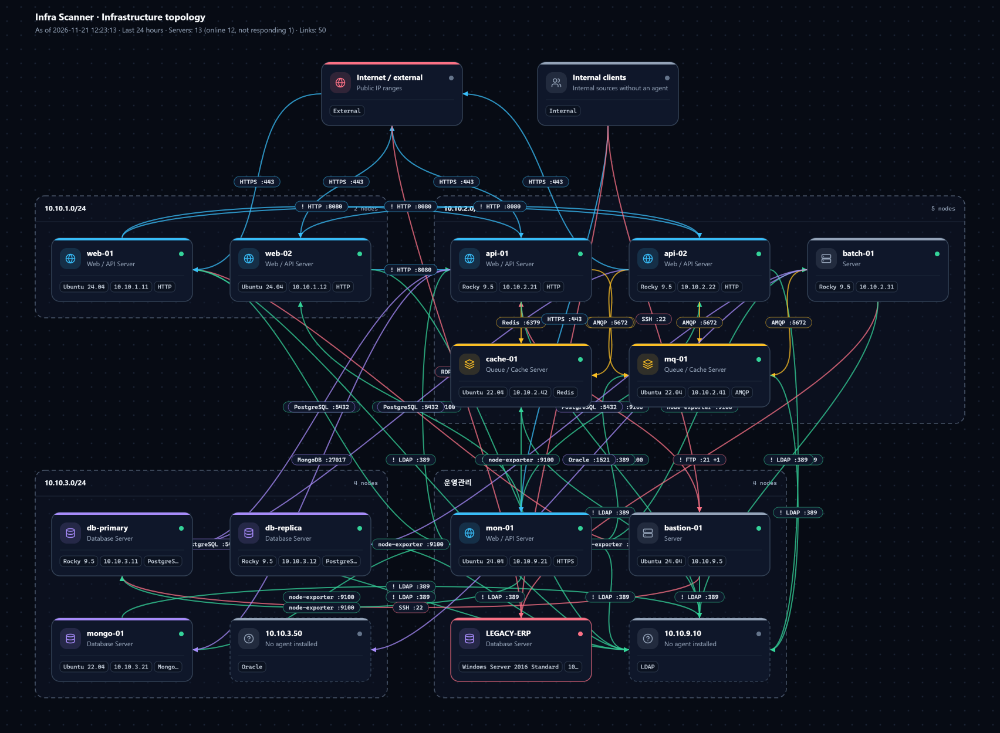
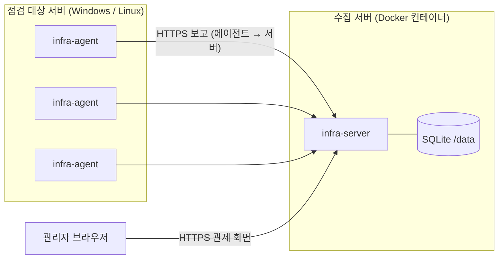

<<<<<<< HEAD
# Infra Scanner

**한국어** | [English](README.en.md)

서버에 설치한 에이전트가 수집한 정보로 **데이터센터 구성도를 자동으로 그리고 점검 항목을 찾아 주는** 웹 앱입니다.

> **누구나 사용할 수 있습니다.** 이 저장소는 공개(Public) 저장소이며 [MIT 라이선스](LICENSE)로 배포합니다. 개인·회사·기관 누구나 무료로 사용, 수정, 재배포할 수 있고 상업적 이용도 가능합니다. 별도의 허가나 등록은 필요 없습니다.
>
> **Free for everyone.** This is a public repository released under the [MIT License](LICENSE). Anyone may use, modify and redistribute it, including for commercial purposes. The web UI is available in Korean, English and Chinese. The manual is available in Korean (this page) and in [English](README.en.md).
>
> **任何人都可以使用。** 本仓库为公开仓库，基于 [MIT 许可证](LICENSE) 发布。任何个人或组织都可以免费使用、修改和再分发，也可用于商业用途。界面支持韩语、英语和中文；手册提供韩语版（本页）和[英语版](README.en.md)。



*데모 데이터(`demo-seed`)로 만든 구성도를 화면의 "PNG 저장"으로 내보낸 그림입니다.*

## 목차

- [구현 목적](#구현-목적)
- [주요 기능](#주요-기능)
- [동작 방식](#동작-방식)
- [빠른 시작 (Docker)](#빠른-시작-docker)
- [에이전트 설치](#에이전트-설치)
- [화면 사용법](#화면-사용법)
- [언어 전환 (한국어 / English / 中文)](#언어-전환-한국어--english--中文)
- [점검 항목](#점검-항목)
- [설정 (환경 변수)](#설정-환경-변수)
- [보안](#보안)
- [수집하는 정보](#수집하는-정보)
- [운영](#운영)
- [소스에서 빌드하고 데모 실행하기](#소스에서-빌드하고-데모-실행하기)
- [API](#api)
- [프로젝트 구조](#프로젝트-구조)
- [알려진 제한과 검증 범위](#알려진-제한과-검증-범위)
- [라이선스와 사용 조건](#라이선스와-사용-조건)

## 구현 목적

구성도는 대개 사람이 손으로 그리고, 그린 날부터 실제 환경과 어긋나기 시작합니다. 장애나 보안 점검 때 "이 서버는 어디와 통신하는가"를 물으면 문서가 아니라 담당자의 기억에 기대게 됩니다.

Infra Scanner 는 이 문제를 다음과 같이 풉니다.

1. **구성도를 그리지 않고 관측한다.** 각 서버의 에이전트가 열려 있는 포트와 실제로 맺어진 TCP 연결을 읽어 보고하고, 수집 서버가 이를 서로 맞춰 서버 사이의 연결선을 만듭니다. 구성도는 항상 지금 관측된 사실을 보여 줍니다.
2. **Windows 와 Linux 를 같은 방식으로 다룬다.** 에이전트는 의존성 없는 실행 파일 하나이고, 설치 명령 한 줄로 서비스로 등록됩니다.
3. **보는 것에서 끝나지 않고 점검한다.** 응답 없는 에이전트, 가득 찬 디스크, 인터넷에서 닿는 관리·DB 포트, 평문일 수 있는 통신, 에이전트가 없는 서버를 자동으로 찾아 등급별로 보여 줍니다.
4. **배포가 단순하다.** 수집 서버는 Docker 컨테이너 하나이고, 데이터는 SQLite 파일 하나입니다. 별도의 DB 나 메시지 큐가 필요 없습니다.
5. **여러 나라의 운영자가 함께 쓴다.** 화면을 한국어, 영어, 중국어로 바꿔 볼 수 있습니다.

화면 디자인은 저장소의 `test.html`(손으로 구성도를 그리는 편집기)을 따랐습니다. Infra Scanner 는 같은 모양의 구성도를 에이전트가 수집한 사실로 자동으로 채웁니다.

## 주요 기능

| 구분 | 내용 |
| --- | --- |
| 자동 구성도 | 서버 노드, 서브넷 또는 지정한 영역 단위의 묶음, 서비스별 색으로 구분한 연결선 |
| 서버 간 연결 | 한 서버가 보고한 상대 주소를 다른 에이전트의 주소와 맞춰 연결. 양쪽에 에이전트가 있으면 접속하는 프로세스와 받는 프로세스 이름까지 표시 |
| 에이전트 없는 대상 | 에이전트가 없는 내부 주소는 "에이전트 미설치" 노드로, 공인 IP 와 내부 클라이언트는 각각 하나의 묶음 노드로 표시 |
| 서버 상세 | OS, 커널, CPU, 메모리, 디스크, 네트워크 인터페이스, 리스닝 포트, 들어오고 나가는 통신 |
| 점검 항목 | 14종의 점검을 높음 / 중간 / 낮음 등급으로 표시 ([점검 항목](#점검-항목)) |
| 기간 선택 | 최근 1시간, 6시간, 24시간, 7일, 30일 동안 관측된 통신만 그리기 |
| 배치 | 노드와 영역을 끌어서 옮기면 서버에 저장. "자동 배치"로 되돌리기 |
| 내보내기 | 구성도를 PNG 또는 JSON 으로 저장 |
| 다국어 | 한국어, English, 中文(简体) |
| 배포 | Docker 이미지 하나에 수집 서버와 Linux(amd64, arm64) · Windows(amd64) 에이전트 포함 |

## 동작 방식



1. **등록.** 에이전트는 설치할 때 등록 토큰(`ENROLL_TOKEN`)으로 수집 서버에 한 번 등록하고, 그 서버 전용 토큰을 발급받습니다. 등록 토큰은 설정 파일에서 지워집니다.
2. **수집.** 에이전트는 10초마다 열려 있는 소켓을 읽어 "어느 프로세스가 어느 주소의 어느 포트와 연결돼 있는가"를 모으고, 보고 주기(기본 60초)마다 서버 정보와 함께 보냅니다. 패킷 내용은 읽지 않습니다.
3. **연결.** 수집 서버는 보고에 담긴 상대 주소를 다른 에이전트가 보고한 인터페이스 주소와 맞춥니다. 맞는 에이전트가 있으면 서버와 서버를 잇고, 없으면 내부 주소는 "에이전트 미설치" 노드로, 공인 주소는 "인터넷" 노드로 묶습니다.
4. **표시.** 브라우저는 30초마다 구성도와 점검 결과를 다시 받아 그립니다.

통신은 항상 **에이전트가 수집 서버로 접속하는 한 방향**입니다. 수집 서버가 대상 서버로 접속하거나 명령을 내리는 기능은 없으므로, 대상 서버에 새로 열어야 하는 포트가 없습니다.

## 빠른 시작 (Docker)

필요한 것은 Docker 와 Docker Compose 입니다.

```bash
git clone <이 저장소 주소>
cd infra_scanner
cp .env.example .env
```

`.env` 를 열어 두 값을 채웁니다.

| 값 | 설명 |
| --- | --- |
| `ADMIN_PASSWORD` | 관제 화면 로그인 비밀번호. 12자 이상 |
| `ENROLL_TOKEN` | 에이전트 등록 토큰. 24자 이상의 무작위 값. `openssl rand -base64 32` 로 만들 수 있습니다 |

서버에 접속할 이름이나 IP 를 `TLS_HOSTS` 에 적어 두면(예: `TLS_HOSTS=scanner.example.internal,10.0.0.5`) 자체 서명 인증서에 그 이름이 들어갑니다.

```bash
docker compose up -d --build
docker compose logs -f
```

브라우저에서 `https://<서버 주소>:8443` 을 엽니다. 기본 설정(`TLS_MODE=selfsigned`)에서는 서버가 인증서를 직접 만들기 때문에 브라우저가 처음에 인증서 경고를 보여 줍니다. 로그에 찍힌 "서버 인증서 SHA-256 지문"과 브라우저가 보여 주는 지문이 같은지 확인하고 진행하세요. 사내 CA 인증서를 쓰려면 [설정](#설정-환경-변수)의 `TLS_MODE=files` 를 보세요.

사내망의 TLS 검사 장비 때문에 빌드가 `x509: certificate signed by unknown authority` 로 실패하면 `docker/certs/README.txt` 를 따르세요.

## 에이전트 설치

1. 관제 화면 오른쪽 위의 **에이전트 설치**를 누릅니다.
2. **수집 서버 주소**에 대상 서버에서 수집 서버로 접속할 수 있는 주소를 넣습니다. 필요하면 **영역 이름**을 넣습니다(예: `운영-DMZ`). 비우면 서브넷 단위로 자동으로 묶입니다.
3. 화면에 나온 명령을 복사해 대상 서버에서 실행합니다. `<ENROLL_TOKEN>` 자리에는 `.env` 에 넣은 값을 넣습니다.

명령은 다음과 같은 모양입니다. 실제 주소, 파일 해시, 인증서 지문은 화면이 채워 줍니다.

Linux (root 권한):

```bash
curl -fkLo infra-agent https://scanner.example.internal:8443/downloads/infra-agent-linux-amd64
echo "<화면에 표시된 SHA-256>  infra-agent" | sha256sum -c - && chmod +x infra-agent
sudo ./infra-agent install -server https://scanner.example.internal:8443 -token '<ENROLL_TOKEN>' -server-cert-sha256 <화면에 표시된 지문>
```

Windows (관리자 권한 PowerShell):

```powershell
curl.exe -fkLo infra-agent.exe https://scanner.example.internal:8443/downloads/infra-agent-windows-amd64.exe
if ((Get-FileHash .\infra-agent.exe -Algorithm SHA256).Hash -ne "<화면에 표시된 SHA-256>") { throw "SHA-256 mismatch" }
.\infra-agent.exe install -server https://scanner.example.internal:8443 -token "<ENROLL_TOKEN>" -server-cert-sha256 <화면에 표시된 지문>
```

`-k` 는 자체 서명 인증서일 때만 붙습니다. 내려받을 때 인증서 검증을 건너뛰는 대신 바로 다음 줄에서 파일의 SHA-256 을 화면의 값과 비교하고, 에이전트는 `-server-cert-sha256` 로 지정한 지문의 인증서에만 접속합니다.

설치하면 1분 안에 구성도에 서버가 나타납니다.

### 에이전트 명령

| 명령 | 설명 |
| --- | --- |
| `infra-agent install -server URL -token TOKEN [옵션]` | 등록하고 서비스로 설치해 시작합니다. 다시 실행하면 업그레이드나 재설치가 됩니다 |
| `infra-agent uninstall [-purge]` | 서비스를 제거합니다. `-purge` 는 설정과 등록 정보도 지웁니다 |
| `infra-agent run [-config PATH]` | 서비스 없이 포그라운드로 실행합니다 |
| `infra-agent once [-zone NAME]` | 한 번 수집해 JSON 으로 출력합니다. 전송하지 않으므로 무엇이 보내지는지 미리 볼 수 있습니다 |
| `infra-agent version` | 버전을 출력합니다 |

`install` 옵션:

| 옵션 | 설명 |
| --- | --- |
| `-zone NAME` | 구성도에서 묶을 영역 이름. 없으면 서브넷으로 묶습니다 |
| `-interval N` | 보고 주기(초). 기본 60, 범위 15~3600 |
| `-ca FILE` | 사내 CA 인증서(PEM). 수집 서버 인증서를 이 CA 로 검증합니다 |
| `-server-cert-sha256 FP` | 자체 서명 서버 인증서의 SHA-256 지문. 이 인증서에만 접속합니다 |
| `-allow-http` | 평문 HTTP 서버를 허용합니다. 시험용입니다 |

설치 위치:

| | Windows | Linux |
| --- | --- | --- |
| 실행 파일 | `%ProgramFiles%\InfraScanner\infra-agent.exe` | `/usr/local/bin/infra-agent` |
| 설정과 토큰 | `%ProgramData%\InfraScanner\` (`agent.json`, `state.json`) | `/etc/infra-scanner/` |
| 서비스 이름 | `InfraScannerAgent` | `InfraScannerAgent` |
| 로그 | `%ProgramData%\InfraScanner\agent.log` | 서비스 관리자의 로그 (systemd 라면 `journalctl -u InfraScannerAgent`) |

에이전트는 관리자(root) 권한으로 실행해야 다른 프로세스의 이름을 읽을 수 있습니다. `install` 은 관리자 권한이 없으면 설치를 거부합니다.

## 화면 사용법

### 로그인

`ADMIN_PASSWORD` 로 로그인합니다. 같은 주소에서 5번 틀리면 5분 동안 잠깁니다. 로그인은 12시간 유지됩니다.

### 위쪽 막대

| 항목 | 설명 |
| --- | --- |
| 서버 / 온라인 / 응답 없음 / 미설치 / 연결 | 현재 수치입니다. 창이 좁으면 중요한 것부터 남기고 나머지는 숨깁니다 |
| 점검 `높음/중간/낮음` | 점검 항목 수입니다. 누르면 오른쪽에 전체 현황과 점검 결과가 열립니다 |
| 기간 | 이 기간 안에 관측된 통신만 그립니다 |
| 외부 | 인터넷 / 내부 클라이언트 노드를 보이거나 숨깁니다 |
| 미설치 | 에이전트가 없는 내부 서버를 보이거나 숨깁니다 |
| 공통 | 모니터링, DNS, LDAP, NTP 처럼 모든 서버가 공통으로 쓰는 연결을 보이거나 숨깁니다. 끄면 업무 흐름만 남습니다 |
| 라벨 / 흐름 | 연결선의 라벨과 흐름 애니메이션을 켜고 끕니다 |
| 자동 배치 | 저장된 배치를 지우고 자동으로 다시 배치합니다 |
| PNG / JSON 저장 | 지금 보이는 구성도를 파일로 저장합니다. JSON 은 `test.html` 편집기의 "JSON 불러오기"로 열 수 있는 형식입니다 |
| 에이전트 설치 | 설치 명령을 보여 줍니다 |
| 언어 | 한국어 / English / 中文 ([언어 전환](#언어-전환-한국어--english--中文)) |
| 로그아웃 | 로그인을 끝냅니다 |

### 구성도

- **노드**를 누르면 오른쪽에 상세 화면이 열립니다. 끌면 위치가 바뀌고 서버에 저장됩니다.
- **영역**의 제목 줄을 끌면 영역 전체가 움직입니다.
- **연결선**을 누르면 그 연결의 서비스, 프로세스, 동시 연결 수, 마지막 관측 시각이 나옵니다. 라벨 앞의 `!` 는 평문일 수 있는 통신이 섞여 있다는 뜻입니다(포트 기준 추정).
- 빈 곳을 끌면 화면이 이동하고, 마우스 휠이나 오른쪽 아래 버튼으로 확대, 축소, 화면에 맞춤, 새로 고침을 할 수 있습니다.
- 노드 오른쪽 위의 점은 상태입니다: 초록(온라인), 빨강(응답 없음), 주황(보고 대기), 회색(에이전트 없음 / 외부).
- 연결선 색: 하늘색(웹 / API), 보라(데이터베이스), 주황(큐 / 캐시), 빨강(관리 접속), 초록(인프라 서비스), 회색(기타).

### 왼쪽 목록

영역별 서버 목록입니다. 호스트명, IP, 서비스 이름으로 검색할 수 있고, 항목을 누르면 구성도가 그 서버로 이동합니다.

### 오른쪽 화면

- **전체 현황**: 수치와 점검 결과. 등급별로 걸러 볼 수 있고, 항목을 누르면 해당 서버나 연결로 이동합니다.
- **서버 상세**: 시스템 정보, 자원 사용률, 네트워크 인터페이스, 리스닝 포트, 나가는 통신, 들어오는 통신, 서버 안의 통신. 맨 아래의 "이 서버를 목록에서 삭제"는 수집 기록과 에이전트 등록을 지웁니다. 에이전트가 계속 돌고 있으면 인증에 실패하므로, 다시 보고받으려면 그 서버에서 에이전트를 다시 설치해야 합니다.
- **연결 상세**: 접속하는 쪽과 받는 쪽, 서비스별 프로세스와 관측 시각.

서버가 **응답 없음**으로 바뀌는 기준은 보고 주기의 3배(최소 3분) 동안 보고가 없을 때입니다.

## 언어 전환 (한국어 / English / 中文)

- 로그인 화면과 위쪽 막대의 지구본 모양 선택 상자에서 **한국어 / English / 中文** 을 고릅니다. 다시 불러오지 않고 화면 전체가 바로 바뀝니다.
- 고른 언어는 그 브라우저에 저장됩니다. 고른 적이 없으면 브라우저의 언어 설정을 따르고, 세 언어에 해당하지 않으면 영어로 보입니다.
- 중국어는 간체(简体中文)입니다.
- 바뀌는 범위: 메뉴와 버튼, 상태, 점검 항목의 제목과 설명, 오류 메시지, 설치 안내, PNG 내보내기의 머리글, JSON 내보내기의 점검 문장.
- 바뀌지 않는 것: 호스트명, 영역 이름처럼 사용자가 정한 값과 운영체제가 준 값(OS 이름, 프로세스 이름, 에이전트 경고의 원인 문장).
- 에이전트의 명령줄 출력과 수집 서버의 로그는 한국어입니다. API 오류 응답은 한국어 문장(`error`)과 함께 언어와 무관한 코드(`code`)를 줍니다.

### 언어를 추가하려면

1. `web/static/i18n.js` 에 새 언어 블록을 추가합니다. 키는 영어(`en`)와 똑같아야 하고 `{이름}` 자리표시자도 같아야 합니다.
2. `web/static/app.js` 의 `LANGS` 에 `['코드', '표시 이름', 'html lang 값']` 을 한 줄 추가합니다.
3. `internal/server/i18n_test.go` 의 `uiLanguages` 에 코드를 추가하고 `go test ./internal/server` 를 돌립니다. 빠진 키나 맞지 않는 자리표시자를 알려 줍니다.

번역을 고치거나 언어를 추가하는 기여를 환영합니다.

## 점검 항목

| 등급 | 항목 | 조건 |
| --- | --- | --- |
| 높음 | 에이전트 응답 없음 | 보고 주기의 3배(최소 3분) 동안 보고가 없음 |
| 높음 | 디스크 여유 공간 부족 | 사용률 95% 이상 |
| 높음 | Telnet 포트 리스닝 | TCP 23 을 루프백이 아닌 주소로 리스닝 |
| 높음 | 외부망에서 관리/DB 포트 접속 관측 | 공인 IP 에서 관리 또는 DB 포트로 들어온 접속이 관측됨 |
| 중간 | 디스크 사용률 높음 | 사용률 90% 이상 |
| 중간 | 메모리 사용률 높음 | 사용률 90% 이상 |
| 중간 | FTP 포트 리스닝 | TCP 21 을 루프백이 아닌 주소로 리스닝 |
| 중간 | 평문 프로토콜 통신 | FTP 또는 Telnet 통신이 관측됨 |
| 낮음 | 평문일 수 있는 통신 (포트 기준 추정) | HTTP, LDAP 처럼 포트 기준으로 평문일 수 있는 통신이 관측됨 |
| 낮음 | 에이전트 미설치 서버 | 에이전트가 있는 서버가 접속하는 내부 주소인데 에이전트가 없음 |
| 낮음 | 등록 후 보고 없음 | 등록은 됐지만 아직 보고가 없음 |
| 낮음 | 프로세스 이름 일부 누락 | 리스닝 포트의 절반 넘게 프로세스 이름을 읽지 못함. 에이전트가 관리자 권한으로 실행되지 않았을 때 생깁니다 |
| 낮음 | 통신 흐름 일부 생략 | 한 번의 보고에 담을 수 있는 흐름 수(1000)를 넘음 |
| 낮음 | 에이전트 수집 경고 | 에이전트가 일부 정보를 읽지 못함 |

서비스 이름과 평문 여부는 **포트 번호로 추정한 값**입니다. 예를 들어 8080 포트의 통신은 "HTTP, 평문일 수 있음"으로 표시되지만 실제로는 TLS 일 수 있습니다. 점검 결과는 확인할 대상을 좁혀 주는 것이지 판정이 아닙니다.

## 설정 (환경 변수)

수집 서버의 설정은 모두 환경 변수입니다. Docker Compose 에서는 `.env` 에 적습니다.

| 변수 | 기본값 | 설명 |
| --- | --- | --- |
| `ADMIN_PASSWORD` | (필수) | 관제 화면 비밀번호. 12자 이상. `.env` 에서 값에 `$` 가 있으면 `$$` 로 적습니다 |
| `ENROLL_TOKEN` | (필수) | 에이전트 등록 토큰. 24자 이상 |
| `TLS_MODE` | `selfsigned` | `selfsigned`: 서버가 인증서를 만들고 에이전트는 지문으로 확인. `files`: 발급받은 인증서 사용. `off`: 평문 HTTP. 앞단의 리버스 프록시가 HTTPS 를 끝낼 때만 쓰세요 |
| `TLS_HOSTS` | (없음) | 자체 서명 인증서에 넣을 이름과 IP. 쉼표로 구분 |
| `TLS_CERT_FILE`, `TLS_KEY_FILE` | (없음) | `TLS_MODE=files` 일 때 인증서와 키의 경로. `docker-compose.yml` 의 `./certs` 볼륨 주석을 풀고 컨테이너 안 경로(`/certs/...`)를 적습니다 |
| `PUBLISH_PORT` | `8443` | 호스트에 여는 포트 (Compose 전용) |
| `RETENTION_DAYS` | `30` | 통신 흐름 기록 보존 기간(일) |
| `COOKIE_SECURE` | `true` | 세션 쿠키에 Secure 속성을 붙입니다. HTTPS 없이 시험할 때만 `false` |
| `VERSION` | `1.0.0` | 이미지 태그와 표시되는 버전 (Compose 전용) |
| `LISTEN_ADDR` | `:8443` | 서버가 듣는 주소. 컨테이너 밖에서 직접 실행할 때 씁니다 |
| `DATA_DIR` | `./data` | SQLite 파일과 자체 서명 인증서를 두는 폴더 (이미지에서는 `/data`) |
| `DOWNLOADS_DIR` | `./downloads` | 에이전트 실행 파일을 두는 폴더 (이미지에서는 `/app/downloads`) |

자체 서명 인증서를 만든 뒤에 `TLS_HOSTS` 를 바꾸려면 볼륨의 `/data/tls` 를 지우고 다시 시작해야 합니다. 이때 지문이 바뀌므로 에이전트도 다시 설치해야 합니다.

## 보안

- **전송 구간 암호화.** 기본값이 HTTPS 입니다. 에이전트는 `http://` 주소를 `-allow-http` 없이는 거부하고, 자체 서명 인증서는 지문으로 고정합니다.
- **토큰.** 등록 토큰은 등록에만 쓰이고 관제 화면에는 표시되지 않습니다. 등록 뒤에는 서버별 전용 토큰을 쓰며, 수집 서버는 그 해시만 저장합니다. 서버를 목록에서 삭제하면 그 토큰은 바로 무효가 됩니다.
- **에이전트 파일.** 토큰이 든 설정 폴더는 관리자만 읽을 수 있게 만듭니다(Linux `0700`, Windows 는 SYSTEM 과 Administrators 만 허용).
- **관제 화면.** 세션 쿠키는 `HttpOnly`, `SameSite=Strict`, `Secure` 이고 로그인 시도 횟수를 제한합니다. 상태를 바꾸는 요청은 전용 헤더를 요구하며, 페이지는 `default-src 'self'` 콘텐츠 보안 정책으로 제공됩니다. 화면은 외부 CDN 을 쓰지 않으므로 인터넷이 막힌 망에서도 동작합니다.
- **컨테이너.** 셸이 없는 distroless 이미지에서 일반 사용자로 실행하고, 루트 파일 시스템은 읽기 전용이며 모든 capability 를 버립니다.
- **단방향.** 수집 서버는 에이전트에 접속하거나 명령을 내릴 수 없습니다.

운영할 때 지켜 주세요.

- `.env` 는 커밋하지 마세요(`.gitignore` 에 들어 있습니다). `ADMIN_PASSWORD` 와 `ENROLL_TOKEN` 은 충분히 길고 무작위인 값을 쓰세요.
- 관리자 계정은 하나이고 사용자별 권한 구분이 없습니다. 관제 화면은 관리망에서만 접속할 수 있게 방화벽으로 제한하세요.
- 수집 서버에는 전체 서버의 구성과 통신 관계가 모입니다. 그 자체로 민감한 정보이므로 서버와 백업을 그에 맞게 보호하세요.

보안 문제를 발견하면 공개 이슈에 재현 방법을 자세히 적기 전에 저장소 관리자에게 먼저 알려 주세요.

## 수집하는 정보

에이전트가 보내는 내용은 대상 서버에서 `infra-agent once` 로 그대로 볼 수 있습니다.

| 수집함 | 수집하지 않음 |
| --- | --- |
| 호스트명, OS 와 커널 버전, 아키텍처, 가상화 종류, 가동 시간 | 패킷 내용, 요청과 응답의 본문 |
| CPU 모델과 사용률, 메모리와 디스크 사용량 | 파일 내용, 환경 변수, 명령줄 인자 |
| 네트워크 인터페이스 이름, MAC, IP | 계정과 비밀번호, 인증서와 키 |
| 리스닝 포트(TCP / UDP)와 그 프로세스 이름 | 사용자 활동, 로그 파일 |
| TCP 연결의 방향, 상대 IP, 서비스 포트, 프로세스 이름, 동시 연결 수 | UDP 통신 흐름 |

## 운영

| 작업 | 방법 |
| --- | --- |
| 로그 보기 | `docker compose logs -f` |
| 상태 확인 | `GET /healthz` (컨테이너에는 HEALTHCHECK 가 들어 있습니다) |
| 업그레이드 | 새 소스를 받은 뒤 `docker compose up -d --build`. 데이터는 `infra-data` 볼륨에 남습니다 |
| 에이전트 업그레이드 | 새 실행 파일로 `install` 을 다시 실행합니다. 토큰 없이 실행하면 기존 등록을 그대로 씁니다 |
| 백업 | `infra-data` 볼륨(`/data`)을 백업합니다. `infra-scanner.db` 와 `tls/` 가 들어 있습니다. 컨테이너를 멈춘 상태에서 복사하는 것이 안전합니다 |
| 서버 제거 | 대상 서버에서 `infra-agent uninstall -purge` 를 실행한 뒤 관제 화면에서 "이 서버를 목록에서 삭제" |
| 등록 토큰 교체 | `.env` 의 `ENROLL_TOKEN` 을 바꾸고 다시 시작합니다. 이미 등록된 에이전트는 영향을 받지 않습니다 |

## 소스에서 빌드하고 데모 실행하기

Go 1.27.4 이상이 필요합니다(`go.mod` 기준). 화면의 정적 파일은 서버 실행 파일에 포함되므로 `web/static` 을 고치면 서버를 다시 빌드해야 합니다.

```bash
go test ./internal/...

go build -o dist/infra-server ./cmd/server
go build -o dist/demo-seed ./cmd/demo-seed
GOOS=linux   GOARCH=amd64 go build -o dist/downloads/infra-agent-linux-amd64       ./cmd/agent
GOOS=windows GOARCH=amd64 go build -o dist/downloads/infra-agent-windows-amd64.exe ./cmd/agent
```

에이전트 없이 화면을 둘러보려면 데모 데이터를 넣습니다. `demo-seed` 는 가상의 서버 13대가 보고하는 것처럼 수집 서버에 데이터를 보냅니다.

```bash
export ADMIN_PASSWORD='로컬에서만-쓰는-비밀번호'
export ENROLL_TOKEN="$(openssl rand -base64 32)"
export LISTEN_ADDR=127.0.0.1:8080 TLS_MODE=off COOKIE_SECURE=false
export DATA_DIR=dist/demo-data DOWNLOADS_DIR=dist/downloads
./dist/infra-server &

./dist/demo-seed -server http://127.0.0.1:8080 -allow-http -loop
```

`http://127.0.0.1:8080` 을 엽니다. `TLS_MODE=off` 와 `COOKIE_SECURE=false` 는 자기 PC 에서 시험할 때만 쓰세요.

## API

| 메서드와 경로 | 인증 | 설명 |
| --- | --- | --- |
| `GET /healthz` | 없음 | 상태 확인 |
| `POST /api/v1/agent/enroll` | 등록 토큰 | 에이전트 등록. 서버 전용 토큰 발급 |
| `POST /api/v1/agent/report` | 에이전트 토큰 | 수집 결과 보고 |
| `GET /downloads/{name}` | 없음 | 에이전트 실행 파일 |
| `POST /api/v1/login`, `POST /api/v1/logout`, `GET /api/v1/me` | 비밀번호 / 세션 | 관제 화면 로그인 |
| `GET /api/v1/topology?window=24h` | 세션 | 구성도, 수치, 점검 항목 |
| `GET /api/v1/hosts/{id}`, `DELETE /api/v1/hosts/{id}` | 세션 | 서버 상세, 삭제 |
| `PUT /api/v1/layout`, `DELETE /api/v1/layout` | 세션 | 배치 저장, 초기화 |
| `GET /api/v1/install-info` | 세션 | 설치 안내에 쓰는 정보 |

응답의 문장은 언어와 무관하게 만들어져 있습니다. 점검 항목은 문장 대신 `code` 와 `args` 를 주고(예: `{"severity":"high","code":"agent_offline","args":{"host":"db-01","age_sec":340}}`), 오류는 `{"code":"bad_password","error":"..."}` 형식입니다. 화면은 `web/static/i18n.js` 의 `f.<code>.title`, `f.<code>.detail`, `err.<code>` 로 선택된 언어의 문장을 만듭니다.

## 프로젝트 구조

```text
cmd/
  agent/        infra-agent: 설치, 제거, 실행 명령
  server/       infra-server: 수집 서버
  demo-seed/    데모 데이터를 보내는 도구
internal/
  agent/        수집(소켓, 호스트 정보), 등록, 전송
  server/       API, 인증, 저장소(SQLite), 구성도 생성, 점검, TLS
  model/        에이전트와 서버가 주고받는 보고 형식
web/static/     관제 화면: index.html, app.js, app.css, i18n.js (번역)
docker/certs/   빌드 때만 쓰는 사내 CA 를 넣는 폴더
docs/           문서용 그림
Dockerfile, docker-compose.yml, .env.example
test.html       화면 디자인의 기준이 된 구성도 편집기 (단독으로 열어 쓰는 파일)
```

외부 의존성은 [gopsutil](https://github.com/shirou/gopsutil)(BSD-3-Clause), [kardianos/service](https://github.com/kardianos/service)(zlib), [modernc.org/sqlite](https://gitlab.com/cznic/sqlite)(BSD-3-Clause)입니다. 화면은 프레임워크 없이 작성했습니다.

## 알려진 제한과 검증 범위

- **짧은 연결은 빠질 수 있습니다.** 10초마다 소켓을 읽는 방식이라 그 사이에 열렸다 닫힌 연결은 관측되지 않습니다. 패킷 캡처나 eBPF 기반 도구를 대신하지 않습니다.
- **서비스 이름과 평문 여부는 포트 번호로 추정합니다.**
- **TCP 흐름만 연결선이 됩니다.** UDP 는 리스닝 포트만 수집합니다.
- **NAT 나 로드밸런서 뒤의 통신**은 에이전트가 본 주소 그대로 표시되므로, 실제 상대 서버와 이어지지 않을 수 있습니다. 여러 서버가 똑같이 가진 주소(예: `docker0`)는 누구인지 알 수 없어 연결에 쓰지 않습니다.
- **컨테이너 안의 통신**은 호스트의 소켓으로 보이는 범위까지만 수집합니다.
- **관리자 계정은 하나**이고 사용자별 권한, 감사 로그, 알림(메일, 메신저) 기능은 없습니다.
- **에이전트의 명령줄 출력과 서버 로그는 한국어**입니다.
- **검증 범위.** 단위 시험과, Windows 에서 수집 서버를 직접 실행해 데모 데이터로 화면을 확인하는 범위까지 검증했습니다. Docker 이미지 빌드, Windows / Linux 에서의 서비스 설치, 수백 대 이상의 규모는 아직 실제 환경에서 검증하지 못했습니다. 운영에 넣기 전에 시험 환경에서 먼저 확인하세요.

## 라이선스와 사용 조건

[MIT 라이선스](LICENSE)입니다.

- **누구나** 무료로 사용, 복사, 수정, 병합, 배포, 재배포, 판매할 수 있습니다. 개인, 회사, 기관을 가리지 않고 상업적 이용도 가능합니다.
- 조건은 하나입니다. 복사본이나 주요 부분에 저작권 표시와 라이선스 전문을 함께 두세요.
- 소프트웨어는 "있는 그대로" 제공되며 어떤 보증도 없습니다. 사용에 따른 책임은 사용자에게 있습니다.
- 에이전트는 **본인이 소유하거나 관리 권한을 가진 서버에만** 설치하세요. 권한 없는 시스템의 정보를 수집하는 것은 대부분의 나라에서 불법입니다.

버그 신고, 기능 제안, 번역 수정, 풀 리퀘스트를 환영합니다.
=======
# rei
>>>>>>> 25989fc5bbdf3ceba50dc03f0956ef6194b0659f
